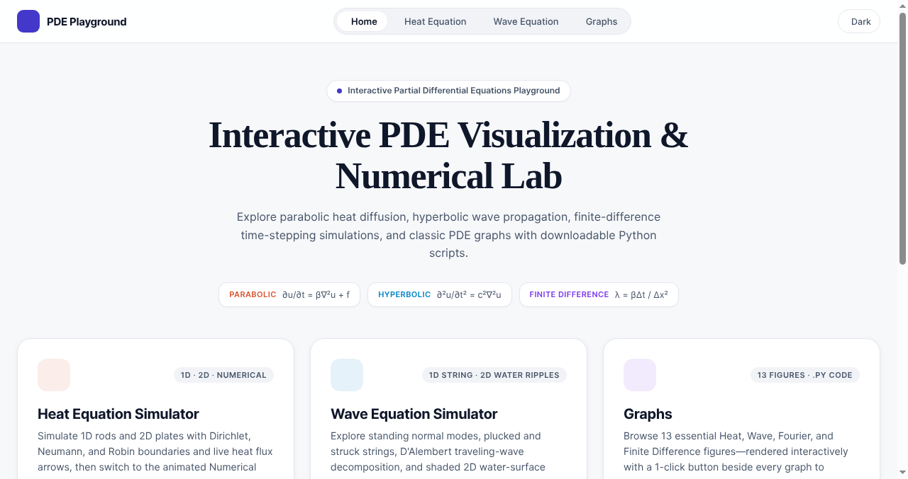
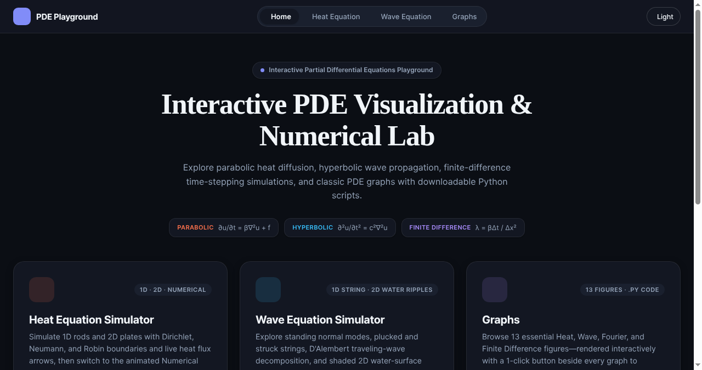
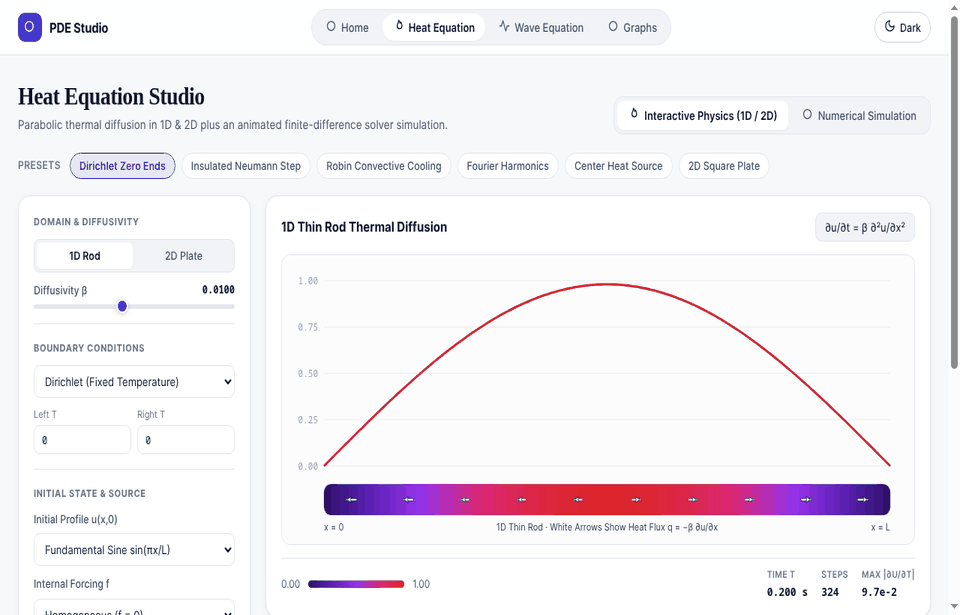
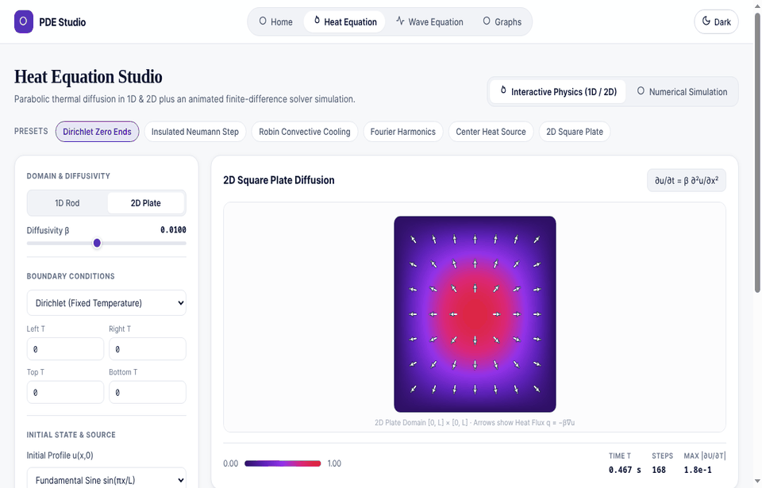
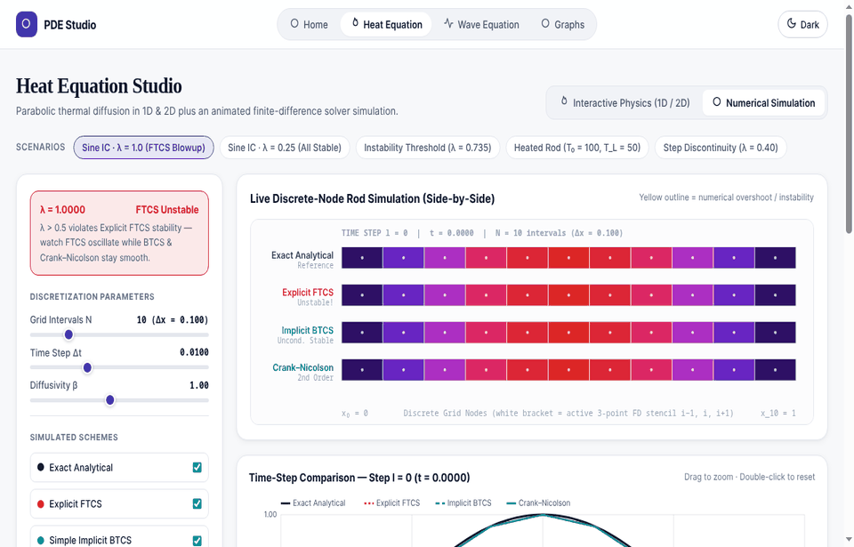
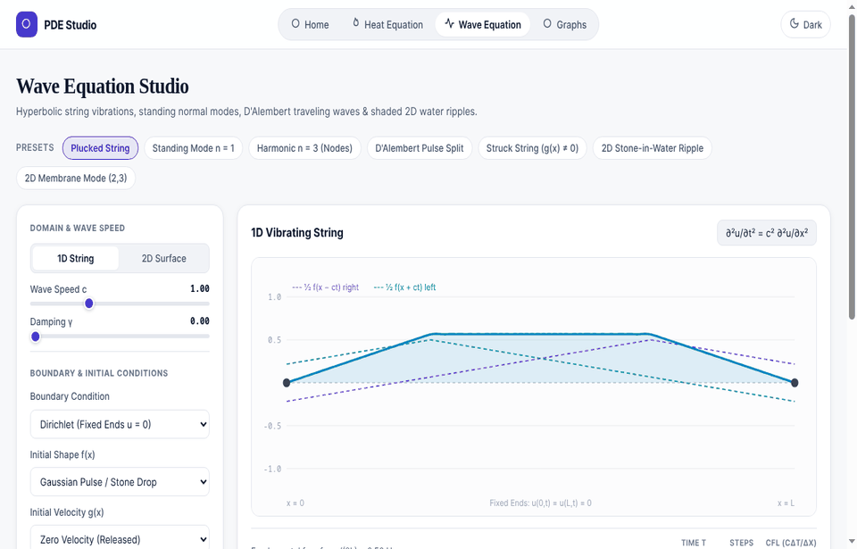
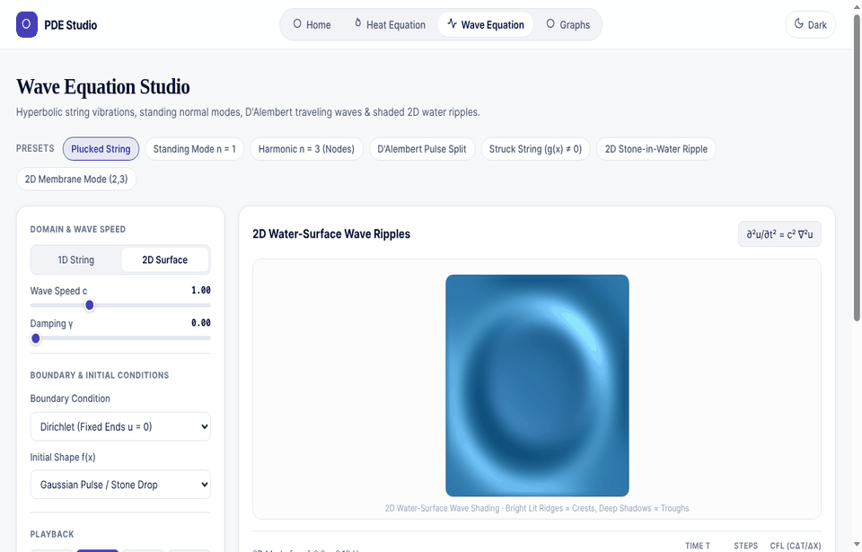
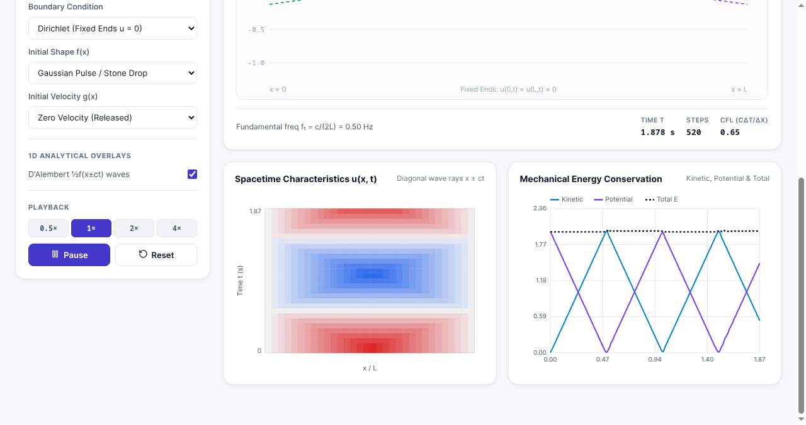
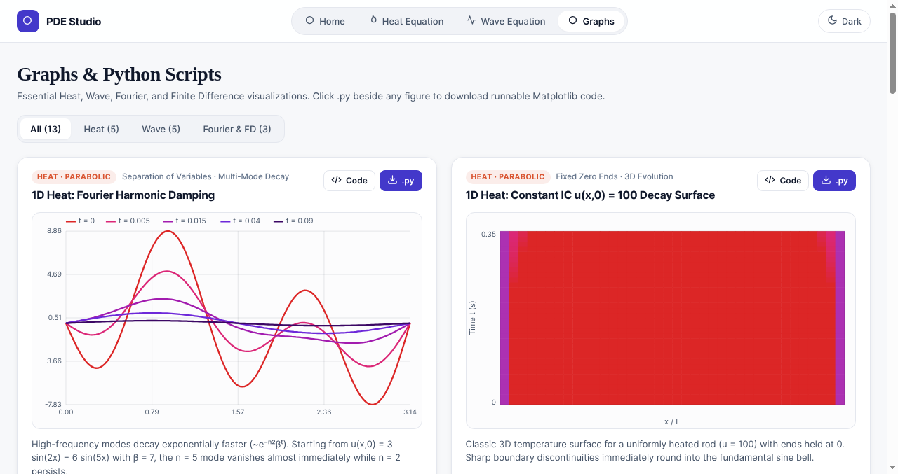
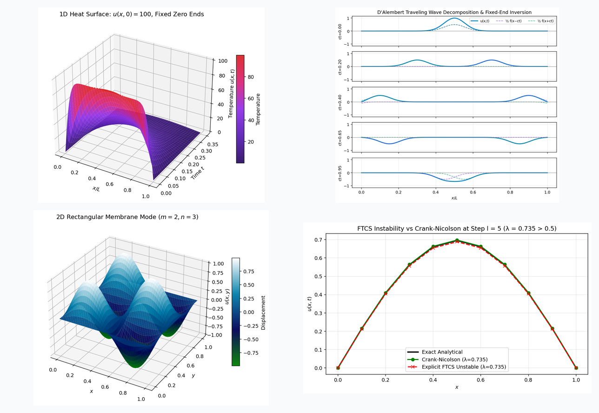

# PDE Playground — Interactive Partial Differential Equations Visualization & Numerical Lab

[](#license)
[](#project-structure)
[](#mathematical-formulations)
[](#graphs--downloadable-python-scripts)

**PDE Playground** is a zero-build, browser-based scientific visualization platform for exploring **parabolic heat diffusion**, **hyperbolic wave propagation**, **animated finite-difference time-stepping**, and **13 classic PDE figures** with one-click downloadable Python (`matplotlib` / `numpy`) scripts.

<p align="center">
  
  
</p>

---

## Key Features

| Module | Capabilities |
| :--- | :--- |
| **Heat Equation Simulator** | 1D thin rod & 2D square plate thermal diffusion with **Dirichlet**, **Neumann** (insulated), and **Robin** (convective) boundary conditions; Violet → Red thermal colormap; live heat-flux arrows ($q = -\beta \nabla u$) on both 1D rods and 2D plates; internal forcing sources; interactive spatial profile & spacetime heatmap. |
| **Animated Numerical Simulation** | Live side-by-side discrete-node rod simulation inside Heat Simulator comparing **Exact Analytical**, **Explicit FTCS**, **Simple Implicit BTCS**, and **Crank–Nicolson** across time steps $l = 0, 1, 2, \dots$ with live stability indicator ($\lambda = \beta \Delta t / \Delta x^2$), active 3-point stencil highlights, numerical overshoot markers, $L_\infty$ error tracking, and nodal value table. |
| **Wave Equation Simulator** | 1D vibrating string (standing normal modes, plucked/struck strings, **D'Alembert** $\frac{1}{2}f(x \pm ct)$ decomposition, context-aware interior node markers) and **2D water-surface wave ripples** with Blinn–Phong crest/trough shading; real-time spacetime characteristics and mechanical energy conservation ($E_k, E_p, E_{\text{total}}$). |
| **Graphs & Python Scripts** | 13 interactive PDE visualizations spanning Heat, Wave, Fourier Series (Gibbs phenomenon), and Finite Difference methods—each paired with a live code preview modal and a 1-click `.py` download button for standalone Matplotlib reproduction. |
| **Dual Academic Theme** | Clean **Academic Light** default with instant **Refined Dark** toggle, KaTeX math rendering, and responsive Plotly.js charts with live zoom persistence (`uirevision`). |

---

## Visual Walkthrough

### 1. Heat Equation Simulator (1D Rod & 2D Plate)

Observe Fourier heat conduction with a continuous **Violet (cold) → Red (hot)** colormap and live white flux arrows indicating local heat flow direction $q = -\beta \nabla u$ in both 1D and 2D domains.

<p align="center">
  
  
</p>

### 2. Animated Finite-Difference Numerical Simulation

Step through discrete time levels $l = 0, 1, 2, \dots$ or run continuous playback to watch how **Explicit FTCS** develops checkerboard oscillations when $\lambda = \beta \Delta t / \Delta x^2 > 0.5$, while **Implicit BTCS** and second-order **Crank–Nicolson** remain unconditionally stable alongside the exact analytical solution.

<p align="center">
  
</p>

### 3. Wave Equation Simulator (1D D'Alembert & 2D Water Ripples)

Compare 1D traveling-wave decomposition $\frac{1}{2}[f(x-ct) + f(x+ct)]$ with fixed-end inversions alongside shaded **2D water-surface ripples** that render crests as bright lit ridges and troughs as deep shadows.

<p align="center">
  
  
</p>

Live interactive **Spacetime Characteristics** $u(x, t)$ and **Mechanical Energy Conservation** ($E_k$, $E_p$, and conserved $E_{\text{total}}$) update continuously without freezing or losing zoom state:

<p align="center">
  
</p>

### 4. Graphs & Downloadable Python Scripts

Browse all 13 curated Heat, Wave, Fourier, and Finite Difference figures interactively in the browser, inspect the source code in-app, or click **`.py`** beside any figure to download a self-contained Matplotlib script.

<p align="center">
  
  
</p>

---

## Mathematical Formulations

### Parabolic Heat Equation
$$\frac{\partial u}{\partial t} = \beta \nabla^2 u + f(\mathbf{x}, t)$$
- **Boundary Conditions**: Dirichlet ($u = T_0$), Neumann ($\partial u / \partial n = 0$), and Robin ($\partial u / \partial n + h(u - T_\infty) = 0$).
- **Finite-Difference Schemes** (with mesh ratio $\lambda = \frac{\beta \Delta t}{\Delta x^2}$):
  - **Explicit FTCS**: $u_i^{l+1} = u_i^l + \lambda(u_{i+1}^l - 2u_i^l + u_{i-1}^l)$ — conditionally stable for $\lambda \le \frac{1}{2}$.
  - **Simple Implicit BTCS**: $(I - \lambda D_2)\mathbf{u}^{l+1} = \mathbf{u}^l$ — unconditionally stable, solved via Thomas tridiagonal algorithm in $O(N)$.
  - **Crank–Nicolson**: $(I - \frac{\lambda}{2} D_2)\mathbf{u}^{l+1} = (I + \frac{\lambda}{2} D_2)\mathbf{u}^l$ — unconditionally stable and $O(\Delta t^2 + \Delta x^2)$ accurate.

### Hyperbolic Wave Equation
$$\frac{\partial^2 u}{\partial t^2} + 2\gamma \frac{\partial u}{\partial t} = c^2 \nabla^2 u$$
- **Time Integration**: Second-order central differences respecting the Courant–Friedrichs–Lewy condition $\text{CFL} = c \Delta t / \Delta x \le 1$ (1D) and $\le 1/\sqrt{2}$ (2D).
- **Analytical Overlays**: D'Alembert traveling waves $\frac{1}{2}f(x \pm ct)$ and interior standing-wave node markers for Dirichlet normal modes ($m \ge 2$).
- **Energy Diagnostics**: Real-time kinetic energy $E_k = \frac{1}{2}\int u_t^2\,dx$, potential energy $E_p = \frac{1}{2}c^2 \int u_x^2\,dx$, and total mechanical energy $E = E_k + E_p$.

---

## Included Python Scripts (`Graphs` Section)

All 13 downloadable scripts require only `numpy` and `matplotlib`:

| Category | Script Filename | Description |
| :--- | :--- | :--- |
| **Heat** | `heat_fourier_harmonic_damping.py` | Exponential multi-mode harmonic damping ($\sim e^{-n^2 \beta t}$) |
| **Heat** | `heat_constant_ic_3d_surface.py` | 3D temperature decay surface for $u(x,0) = 100$ with zero ends |
| **Heat** | `heat_triangular_peak_smoothing.py` | Instantaneous parabolic smoothing of a sharp triangular corner |
| **Heat** | `heat_insulated_neumann_step.py` | Insulated rod step profile converging to mean temperature |
| **Heat** | `heat_nonhomogeneous_oscillating_bc.py` | Non-homogeneous oscillating boundary condition & steady-periodic state |
| **Wave** | `wave_standing_normal_modes.py` | First four standing normal modes ($n = 1, 2, 3, 4$) with node markers |
| **Wave** | `wave_dalembert_traveling_split.py` | D'Alembert pulse splitting and fixed-end phase inversion |
| **Wave** | `wave_superposition_principle.py` | Linear superposition of two independent harmonic modes |
| **Wave** | `wave_plucked_string_evolution.py` | Plucked triangular string Fourier evolution over half a period |
| **Wave** | `wave_2d_membrane_mode_2_3.py` | 3D surface of rectangular membrane normal mode $(m=2, n=3)$ |
| **Fourier & FD** | `fourier_gibbs_phenomenon.py` | Fourier partial sums of a square wave & ~9% Gibbs overshoot |
| **Fourier & FD** | `fd_heat_rod_3s_intervals.py` | Discrete rod nodal evolution at 3-second intervals |
| **Fourier & FD** | `heat_ftcs_instability_vs_cn.py` | Explicit FTCS blow-up ($\lambda = 0.735 > 0.5$) vs. Crank–Nicolson |

---

## Live Demo (GitHub Pages)

Once published via **Settings → Pages → Deploy from `main` / `(root)`**, your live app will be available at:

```text
https://zashraf-io.github.io/pde-playground/
```

---

## Getting Started

PDE Playground runs directly in any modern browser with **no build step or backend server required**.

```bash
# Option 1: Open directly in your browser
open index.html        # macOS
xdg-open index.html    # Linux
start index.html       # Windows

# Option 2: Serve locally with Python
python3 -m http.server 8000
# Then open http://localhost:8000
```

To run any downloaded Python graph script:

```bash
pip install numpy matplotlib
python3 wave_dalembert_traveling_split.py
```

---

## Project Structure

```text
pde-playground/
├── index.html               # Application shell (Home, Heat, Wave, Graphs views)
├── css/
│   └── style.css            # Dual Light/Dark design tokens & responsive layout
├── js/
│   ├── heat-solver.js       # 1D & 2D Heat PDE solvers (Dirichlet, Neumann, Robin, forcing)
│   ├── heat-numerical.js    # Animated FTCS, BTCS (Thomas), Crank-Nicolson & Exact engine
│   ├── wave-solver.js       # 1D & 2D Wave PDE solvers, D'Alembert & energy diagnostics
│   ├── renderers.js         # High-DPI Canvas renderers (flux arrows, 2D water shading, FD rod)
│   ├── graphs-data.js       # 13 interactive figures + verified Matplotlib Python scripts
│   └── app.js               # Navigation, theme switching, Plotly live charts & modal controller
├── assets/                  # Verified screenshots & animated GIFs used in this README
└── README.md
```

---

## Academic Attribution

Developed for **MTH G202: Special Functions and Partial Differential Equations**  
Department of Biomedical Engineering, Faculty of Engineering, Cairo University.

## License

Released under the MIT License.
